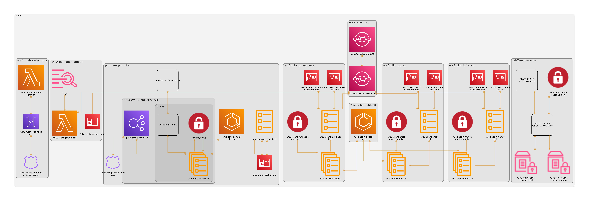

# WIS2.0 Global Cache

## 1. Introduction
This repository contains the WIS2.0 Global Cache service, a caching solution composed of multiple components. The service is deployed using AWS CDK, ensuring a scalable and efficient caching infrastructure.



## 2. Components

### 2.1. MQTT Client Service (paho MQTT - Fargate)
Uses a Fargate cluster to deploy one mqtt listenner client per global broker. Global Broker connection strings are stored in Secrets Manager. The client listens for incoming messages on the appropriate topics using paho MQTT and then queues the messages on SQS.  
`Stack File: deploy/stacks/wis2_client_stack.py`

### 2.2. Queue (SQS)
Deploys an SQS queue to handle message queuing. It ensures reliable message delivery and processing. The queue service includes a dead-letter queue for failed messages and a queue policy for access control.  
`Stack File: deploy/stacks/wis2_queue_stack.py`

### 2.3. Lambda Manager (python Lambda)
The Manager Lambda is responsible for processing messages from the queue. It reads messages from the queue, processes them, stores them in the cache, and publishes the cache messages if successful. 

### 2.4. Metrics and duplicate detection (redis elasticache)
The cache is implemented using redis Elasticache replication enabled cluster. The cache is used to store message data_ids, and their datetimes and to detect duplicate WIS2 notification messages. The cache is also used to store metrics data, such as the number of messages processed, the number of failures, and the datetime of the last successfully downloaded message that are returned by the metrics lambda.

### 2.5. MQTT Broker (EMQX - Fargate)
The local MQTT broker for the GC service. The broker is used to publish cache messages to subscribed clients (other WIS2 global services). An admin dashboard is also available to monitor the broker.

### 2.6. Metrics Lambda (python Lambda)
The Metrics Lambda is responsible for returning metrics data from the redis cache. It reads metrics data from the cache and returns the data to the client. This is coordinated by the API Gateway.

## 3. Deployment
This service is deployed using AWS CDK. The deployment is done in two steps, first deploying the infrastructure and then deploying the services.

### 3.1. Prerequisites

#### 3.1.1. Foundational Components
A number of foundational components are required to deploy the WIS2.0 Global Cache service that are not managed by this repository/CDK. These include:
* An AWS account
* An AWS VPC
* Domain Name System (DNS) configuration 
  * A Route 53 hosted zone
  * A registered domain name
  * A cert for ssl/tls with associated records in the hosted zone
* NAT Gateways (2) for static IP addresses
* An S3 bucket where the assets are stored
  * this is currently managed by the UKMet office and provided by ASDI
* the necessary role to which the necessary permissions are attached. Currently, the `WIS2ManagerLambdaRole` referenced in the wis2_lambda_stack.py.

#### 3.1.2. AWS CDK (Cloud Development Kit)

Follow the [AWS CDK Guide](https://docs.aws.amazon.com/cdk/v2/guide/home.html) for prerequisites and installation
instructions.

### 3.2. Deployment Steps

The best way to log in to the AWS account is to use the AWS CLI. The following command will open a browser window and
ask you to log in to the AWS account.

```bash
aws configure sso
```

or if you already have your profile set up, you can use the following command:

```bash
aws sso login --profile <profile_name>
```

Then you can deploy the stack using the _deploy_ command, ie:

```bash
cdk deploy --all --profile wis2-gc
```

#### 3.2.1. Development deployment

Under the _deploy_ directory there is a corresponding app_dev.py file that can be used to deploy a similar app, to the
development environment. Environment variables and parameters are set in this file and passed to the same stack components used in the
prod app.py file.

```bash
cdk deploy --all --profile wis2-gc --app "python app_dev.py"
```

## 4. Operations (test environment)

The commands in this section use the test environment app, `deploy/app_test_env.py`, with `deploy/wis2test.env`.

### 4.1. Deploying manager Lambda changes

Deploy the broker first, because its ACL is built into the image. The broker drops publishes the ACL denies without
returning an error, so a Lambda deployed first would log events as published while they are lost.

```bash
cd deploy
cdk deploy test-emqx-broker --exclusively --app "python app_test_env.py" --profile <test-profile>
cdk deploy test-wis2-sqs-work test-wis2-manager-lambda test-wis2-metrics-lambda WIS2GCDashboard --exclusively --app "python app_test_env.py" --profile <test-profile>
```

`--exclusively` deploys only the named stacks. Without it, CDK also deploys their dependencies, and the dashboard
depends on the client and broker stacks. Run `cdk diff` with the same arguments first.

Then check end to end: subscribe as `everyone` to `monitor/#` and `cache/#` on the GC broker. After the first
deploy of broker TLS verification (4.6), also check the logs for `GC_RETRY` lines with `error_type=PublishError`.

### 4.2. Cache size limit

The manager Lambda decides whether an item is too large to cache before it reads the body. It uses `Content-Length`
when present and counts bytes while downloading otherwise.

- The limit is the smaller of free `/tmp` space and `MAX_CACHE_BYTES`.
- When `MAX_CACHE_BYTES` is unset, it defaults to 25% of the Lambda memory size (32 MB at the test env's 128 MB).
- An item over the limit is not cached. It is republished on `cache/` with its origin links, and an `item.cache` INFO
  monitoring event is published.

The 25% figure is an estimate, not a measurement. The body is held in memory, and the S3 multipart upload adds
its own buffers. If the estimate is too high, a large item runs the Lambda out of memory, and that is not reported
as an event. To check it, compare "Max Memory Used" in the Lambda `REPORT` log lines, or the "Lambda Memory
Utilization" dashboard widget, against item sizes near the limit. To override it, set `MAX_CACHE_BYTES` through the
stack's `max_cache_bytes` parameter. See `docs/adr/0002-cache-size-limit.md`.

### 4.3. TLS verification of data server downloads

Data server certificates are **not verified** at present. `VERIFY_DATA_SERVER_TLS` in
`manager_lambda/wis2_message.py` is `False`, because several test-environment WIS2 Nodes serve expired or self-signed
certificates (checked 2026-10-15). Production WIS2 Nodes are expected to have valid certificates whenever they use
HTTPS (Guide 2.5.2), so this is meant to be temporary.

To turn verification on, set `VERIFY_DATA_SERVER_TLS = True` and redeploy the Lambda:

```bash
cdk deploy test-wis2-manager-lambda --exclusively --app "python app_test_env.py" --profile <test-profile>
```

With verification on, a data server with an expired, self-signed or wrong-host certificate, or one that does not send
its intermediate certificate, fails. Its items are not cached, and each failure:

- logs `GC_TLS_VERIFY_FAILED` with the data server and data_id;
- publishes an `item.download` ERROR monitoring event with description `SSLError`, for `origin/` notifications;
- increments `wmo_wis2_gc_downloaded_errors_total` for that data server;
- is not retried, because a certificate problem will fail the same way on retry.

Python 3.13 and urllib3 2.x also require TLS 1.2 or later and strict X.509 rules. A check of every data server this
cache had downloaded from found none that failed only because of these stricter rules.

The trusted certificate authorities come from the `certifi` version pinned in `manager_lambda/requirements.txt`.

To find failing data servers once verification is on, use CloudWatch Logs Insights on
`/aws/lambda/test-wis2-manager-lambda`:

```
filter @message like /GC_TLS_VERIFY_FAILED/
| parse @message "dataserver='*'" as dataserver
| stats count() by dataserver
```

Do not turn verification off by setting `DEV-MODE=true`. Dev mode also skips the S3 upload, so `cache/`
notifications would point at objects that do not exist.

### 4.4. Failure handling and retries

Each SQS record that fails is either returned to SQS for one retry or dropped. The work queue is FIFO, with a
15-minute visibility timeout and `maxReceiveCount` 2, so a record that fails twice moves to the dead-letter queue.

| Failure | Retried | Log marker |
|---|---|---|
| Network error, timeout, HTTP 5xx (after the download session's own retries), 408, 429 | yes | `GC_RETRY` |
| S3 upload, Redis, or `cache/` publish error | yes | `GC_RETRY` |
| TLS/certificate error | no | `GC_TLS_VERIFY_FAILED` |
| Other HTTP 4xx (for example 404), integrity failure | no | none (see `error/` and metrics) |
| Anything else (malformed message, unexpected exception) | no | `GC_UNCLASSIFIED_FAILURE` |

Download metrics describe the data server (Guide 2.7.4.1):

- Only download failures increment `wmo_wis2_gc_downloaded_errors_total` and set
  `wmo_wis2_gc_dataserver_status_flag` to 0.
- Success metrics (`downloaded_total`, last download time, status flag 1, `no_cache_total`) are written after the
  `cache/` publish succeeds, so a record retried for a publish failure counts once.
- Integrity failures increment only `wmo_wis2_gc_integrity_failed_total`.
- Errors on the Global Cache side (S3, Redis, broker publish, malformed message) update neither. They appear only
  in the logs, the `GC_*` metrics, the alarms and `error/`. There is no metric that counts them yet.

Embedded content (`properties.content`) is used instead of downloading when it is valid:

- `utf-8` and `base64` content is decoded and checked against `size` and the integrity value. Line breaks in base64
  are ignored; any other character outside the base64 alphabet makes the content invalid. If decoding or a check
  fails, the item is downloaded from its URL and an `item.integrity` WARNING monitoring event is published.
- `gzip` content is valid WIS2 but is not decoded, so that untrusted data is never decompressed. The item is
  downloaded from its URL without an event.

For a retried download failure, the `item.download` monitoring event is published only on the final attempt
(`SQS_MAX_RECEIVE_COUNT`, set from the queue stack), so a failure that the retry recovers from is not reported to the
WIS2 Node or the Global Monitor. Failures that are not retried publish the event straight away.

Every failure still publishes to the internal `error/` topic with a full traceback. A retried record can therefore
publish to `error/` twice, and a retried download failure counts in `downloaded_errors_total` twice.

URL query strings, which can carry presigned tokens, are removed from log lines, tracebacks and the `error` field of
`error/` messages. The original notification embedded in an `error/` message keeps its links unchanged.

A retried record holds up its FIFO message group, which is the data_id, for 15 minutes per attempt. Copies of the same
item from other Global Caches (`cache/` notifications) share that group, so they wait behind it. A transient failure
on the origin therefore delays caching that item from another cache by 15 to 30 minutes. Before retries were enabled,
the failed record was dropped and the next copy was processed straight away.

### 4.5. Monitoring

- **Metrics:** CloudWatch metric filters count the three log markers as metrics in the `WIS2GC` namespace.
- **Dashboard:** the `WIS2-Operations-Dashboard` graphs those metrics and the dead-letter queue depth.
- **Alarms:** the `WIS2GCDashboard` stack creates the alarms below and an SNS topic that emails the address in
  `ALARM_EMAIL` (read from the environment file; synth fails if it is unset). The recipient must click the SNS
  confirmation email once before anything is delivered.

| Alarm | Fires when | Period | Clear email | Usual cause |
|---|---|---|---|---|
| `WIS2GC-DLQ-not-empty` | dead-letter queue has a message | 5 min | yes | records failed both SQS attempts and were not cached |
| `WIS2GC-Manager-Lambda-errors` | Lambda `Errors` >= 1 | 5 min | yes | crash, 15-minute timeout, or out of memory (see 4.2) |
| `WIS2GC-Work-queue-stalled` | oldest work queue message >= 1 hour | 5 min | yes | Lambda not keeping up or not running |
| `WIS2GC-Unclassified-failures` | `GC_UNCLASSIFIED_FAILURE` logged | 1 hour | no | unexpected error, record dropped |
| `WIS2GC-TLS-verify-failures` | `GC_TLS_VERIFY_FAILED` logged | 1 hour | no | a data server's certificate failed verification; fires only when verification is on (see 4.3) |
| `WIS2GC-<client stack>-not-running` | no CPU data from the Global Broker client service for 10 min | 5 min | yes | client task stopped or failing to start |

- **Dead-letter queue alarm:** nothing reads the dead-letter queue, and SQS stops publishing metrics for an idle
  queue, so this alarm keeps its last state when data is missing. It stays in alarm until the queue is purged or
  redriven. Expired messages alone may not clear it. While it is in alarm, new failures do not send another email.
- **Log marker alarms:** these clear without an email after an hour with no matching log line. A data server that
  keeps failing at least once an hour keeps the alarm on and sends no further email. One that fails less often sends
  one email per failure.
- **Client alarm:** ECS reports `CPUUtilization` only while a task runs, so the alarm treats missing data as a
  stopped client. It does not detect a client that runs but is disconnected from the Global Broker. Container
  Insights' `RunningTaskCount` would be more direct, but it is billed per metric.

Logs Insights query for all markers:

```
fields @timestamp, @message
| filter @message like /GC_(RETRY|UNCLASSIFIED_FAILURE|TLS_VERIFY_FAILED)/
| sort @timestamp desc
```

### 4.6. Broker TLS and publish acknowledgements

The manager Lambda publishes `cache/`, `monitor/` and `error/` messages to the GC broker with its own short-lived
MQTT client:

- It verifies the broker's TLS certificate and hostname against the system certificate store.
- It waits for the broker's acknowledgements. A refused connection, a refused publish (for example an ACL denial) or
  no answer raises an error. Each step (TCP connect, TLS handshake, CONNACK, PUBACK) has a 10-second limit. Before
  this change, a refused publish or a missing PUBACK looked like a success.
- It does not reconnect. A lost PUBACK still means the broker may have delivered the message, so the SQS retry can
  publish a second `cache/` notification for the same item, with a different `id`. This is accepted; consumers
  deduplicate on `data_id`.

A failed `cache/` publish is retried through SQS (4.4). A failed `monitor/` publish is logged
(`failed to publish WME`) and does not affect caching.

**Rollback, certificate verification only.** If the broker's certificate fails verification, every `cache/` publish
fails and records move to the dead-letter queue. In `manager_lambda/wis2_lambda_consumer.py`, `publish`, change
`client.tls_insecure_set(False)` to `client.tls_insecure_set(True)`, then redeploy `test-wis2-manager-lambda` with
`--exclusively`. This skips only the hostname check, which is how publishing behaved before; the certificate chain
is still checked.

**Rollback, acknowledgement checks.** Revert the commit that added the MQTT client to `publish`. That restores
`paho.mqtt.publish.single`, which does not wait for broker acknowledgements.

### 4.7. Dead-letter queue

Records that fail both SQS attempts stay on the dead-letter queue for 2 days for inspection. Nothing reads them
automatically. The commands below need the queue's name, which is in the SQS console or the `test-wis2-sqs-work` stack's
CloudFormation exports.

Inspect (read-only apart from the receive count):

```bash
aws sqs get-queue-url --queue-name <dlq-name> --profile <test-profile>
aws sqs receive-message --queue-url <dlq-url> --max-number-of-messages 10 --attribute-names All --profile <test-profile>
```

Then either delete the messages, which also clears the `WIS2GC-DLQ-not-empty` alarm:

```bash
aws sqs purge-queue --queue-url <dlq-url> --profile <test-profile>
```

or, when the cause was on the Global Cache side and has been fixed, move them back to the work queue:

```bash
aws sqs start-message-move-task --source-arn <dlq-arn> --profile <test-profile>
```

A redriven item is published on `cache/` late, after its original notification. Only redrive recent records.

### 4.8. Tests

Run the manager Lambda unit tests in a container, not on a workstation (the handler module deletes files in
`/tmp`):

```bash
docker run --rm -e PYTHONPATH=/src/manager_lambda -v "$PWD/manager_lambda:/src/manager_lambda:ro" \
  -w /src/manager_lambda python:3.13-slim sh -c \
  "pip install -q -r requirements.txt pytest==9.1.1 && python -m pytest -q -p no:cacheprovider"
```
